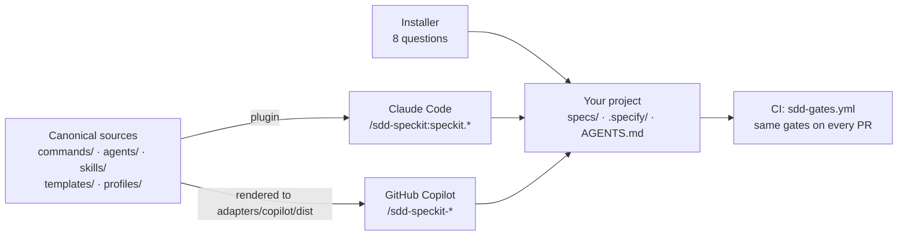
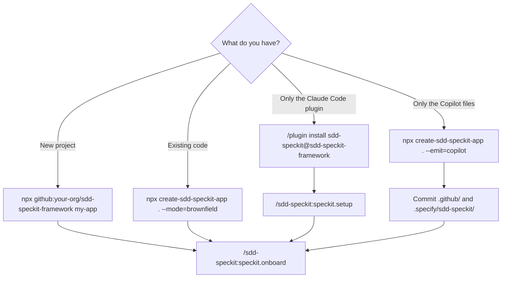
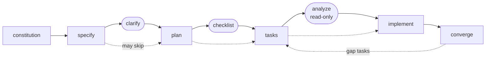

# sdd-speckit-framework

A Spec-Driven Development starter kit for **Claude Code** and **GitHub Copilot**. It packages
GitHub's [Speckit](https://github.com/github/spec-kit) method as a Claude Code plugin, a set of
Copilot skills and agents, harness gates, and a one-command project scaffolder.

You write a spec, then a plan, then tasks, and only then code. The framework provides the
templates, the phase commands and the checks that keep that order.



## What you get

- **Phase workflow.** One command per Speckit phase. Each phase runs in a subagent on a suitable
  model tier.
- **Layered templates.** Each base template is combined with an **industry profile** (general
  SaaS, healthcare, financial services, public sector) and a **stack profile** (Node full-stack,
  Python FastAPI, .NET Aspire).
- **Greenfield and brownfield onboarding.** A new project starts with the constitution. An
  existing codebase starts with discovery.
- **A harness.** Six gates, each set to `off`, `warn` or `block`. The same script runs them in the
  assistant's hooks and in CI.
- **Connectors and editors.** A curated MCP catalog, plus VS Code, Cursor and JetBrains setup.

## Quick start



### New project

```bash
npx github:your-org/sdd-speckit-framework my-app
cd my-app
```

The installer asks eight questions: telemetry, project mode, industry, stack, assistant, MCP
connectors, editor, and harness gates. Then it scaffolds the project. Without Node, run
`./installer/install.sh my-app`. For CI, give every answer as a flag:

```bash
npx create-sdd-speckit-app my-app --yes \
  --industry=healthcare --stack=python-fastapi --assistant=claude \
  --telemetry=off --mcp=github,playwright --editor=vscode
```

`--assistant` takes `claude`, `copilot`, `both`, `cursor` or `other`. Then run
`/sdd-speckit:speckit.onboard` in the project.

### Existing codebase (brownfield)

```bash
cd existing-repo && git checkout -b adopt-sdd
npx create-sdd-speckit-app . --yes --mode=brownfield --industry=financial-services --stack=auto
```

The installer merges with existing files or keeps them. It never replaces them. The gates start at
`warn`. Next, run `onboard → discover → constitution → baseline`. See
[docs/ONBOARDING-GREENFIELD-BROWNFIELD.md](docs/ONBOARDING-GREENFIELD-BROWNFIELD.md).

### Plugin only (Claude Code)

```
/plugin marketplace add your-org/sdd-speckit-framework
/plugin install sdd-speckit@sdd-speckit-framework
```

The `claude plugin …` shell form also works in recent versions. Then run
`/sdd-speckit:speckit.setup` to answer the eight questions in the session. For local development:
`claude --plugin-dir /path/to/this/repo`.

### Files only (GitHub Copilot)

```bash
npx create-sdd-speckit-app . --emit=copilot
```

Commit `.github/` and `.specify/sdd-speckit/`. You do not need to register anything. Without
Node, copy `adapters/copilot/dist/` into the repo. See [docs/COPILOT.md](docs/COPILOT.md).

## The workflow



Rounded boxes are optional quality gates. The order is strict in one place: **specify before
plan**. In a greenfield project, the harness also refuses a source write until the feature has
`spec.md`, `plan.md`, `tasks.md` and a test change.

| Phase | Claude Code | Copilot | Writes | Tier |
|---|---|---|---|---|
| Constitution | `/sdd-speckit:speckit.constitution` | `/sdd-speckit-constitution` | `.specify/memory/constitution.md` | opus |
| Specify | `/sdd-speckit:speckit.specify` | `/sdd-speckit-specify` | `spec.md`, `checklists/requirements.md` | sonnet |
| Clarify | `/sdd-speckit:speckit.clarify` | `/sdd-speckit-clarify` | resolved markers in `spec.md` | sonnet |
| Plan | `/sdd-speckit:speckit.plan` | `/sdd-speckit-plan` | `plan.md`, `research.md`, `data-model.md`, `contracts/`, `quickstart.md` | opus |
| Checklist | `/sdd-speckit:speckit.checklist` | `/sdd-speckit-checklist` | `checklists/<kind>.md` | sonnet |
| Tasks | `/sdd-speckit:speckit.tasks` | `/sdd-speckit-tasks` | `tasks.md` | sonnet |
| Analyze | `/sdd-speckit:speckit.analyze` | `/sdd-speckit-analyze` | **nothing, a report only** | opus |
| Implement | `/sdd-speckit:speckit.implement` | `/sdd-speckit-implement` | source code, `implementation-log.md` | sonnet |
| Converge | `/sdd-speckit:speckit.converge` | `/sdd-speckit-converge` | `converge-report.md`, gap tasks | opus |

Setup and onboarding commands:

| Command (Claude Code) | Writes | Tier |
|---|---|---|
| `speckit.setup` | project config (re-asks any of the eight questions) | sonnet |
| `speckit.onboard` | composed templates, `AGENTS.md`, `CLAUDE.md`, CI gates, harness wiring | sonnet |
| `speckit.discover` | `.specify/discovery/report.md`, `inventory.json` (brownfield) | sonnet |
| `speckit.baseline` | `specs/_baseline/<area>/spec.md`, `.specify/adoption-roadmap.md` (brownfield) | opus |

In Copilot, replace `/sdd-speckit:speckit.X` with `/sdd-speckit-X`.

## What is in the box

| Path | What |
|---|---|
| `commands/` | 13 slash commands: nine phases, `setup`, `onboard`, `discover`, `baseline` |
| `agents/` | 8 subagents, each with a model tier and a tool set for its phase |
| `skills/` | `speckit-workflow`, `raci-lookup`, `telemetry-report`, `asd-ste100` |
| `hooks/hooks.json` | 5 hooks: gates before and after a write, artifact log, tier reminder, usage line |
| `templates/` | 29 base templates: phase artifacts, 5 checklist kinds, 8 project files |
| `profiles/` | 4 industry profiles (with 7 extra checklist kinds) and 3 stack profiles |
| `scripts/` | Template composer, onboarding, discovery scan, gate runner, hook scripts, OTel collector |
| `mcp/`, `editors/` | 6 MCP connectors plus a custom template; VS Code, Cursor and JetBrains files |
| `installer/` | `create-sdd-speckit-app` (Node, includes the Copilot renderer) and `install.sh` (bash) |
| `adapters/copilot/` | Copilot mapping (`adapter.json`) and the committed render (`dist/`) |

## Design choices

- **One source, two assistants.** The Copilot files are generated from the Claude Code sources.
  `npm run check:copilot` fails when the committed render is out of date.
- **Templates are composed, not copied.** Profiles fill named slots in a base template. One script
  does it, so every machine gets the same result.
- **A gate is a guardrail, not a security boundary.** It stops accidents. CI runs the same gates
  on the pull request.
- **Read-only means read-only.** `analyze` and the reviewer agents do not have write tools.
- **Telemetry is off by default.** It is separate from Anthropic's `DISABLE_TELEMETRY`.
- **Rally is never a default.** It is tenant-hosted, so the installer asks for your URL.
- **Industry profiles are engineering guidance, not compliance advice.** Your compliance owner
  must confirm them.
- **Speckit is used, not reimplemented.** The installer calls `specify init`. It falls back to
  vendored templates only when `uvx` is missing, and tells you so.
- **No hook switches models.** Commands and subagents declare their own `model:`.

## Documentation

| Start here | |
|---|---|
| [ONBOARDING.md](ONBOARDING.md) | First-week walk-through for a new team member |
| [Greenfield and brownfield](docs/ONBOARDING-GREENFIELD-BROWNFIELD.md) | Bring a new or existing codebase under the framework |

| Reference | |
|---|---|
| [Installer](docs/INSTALLER.md) | Every flag, both installers, telemetry |
| [Harness](docs/HARNESS.md) | The six gates, modes, CI |
| [Templates](docs/TEMPLATES.md) | Layers, slots, fragments, the composer |
| [Industry profiles](docs/INDUSTRY_PROFILES.md) | What each profile adds, how to tailor one |
| [MCP connectors](docs/MCP_CONNECTORS.md) | Catalog, custom connectors, OAuth |
| [GitHub Copilot](docs/COPILOT.md) | How the framework runs on Copilot, and its limits |
| [Architecture](docs/ARCHITECTURE.md) | How the parts map to Claude Code primitives |
| [Model routing](docs/MODEL_ROUTING.md) | Model tier per phase |
| [RACI](docs/RACI.md) | Who owns which phase |
| [CHANGELOG](CHANGELOG.md) | Version history |

## Requirements

| Tool | Needed for |
|---|---|
| Claude Code and/or GitHub Copilot | Everything (Copilot: VS Code Copilot Chat, the Copilot CLI or the cloud agent) |
| Node 18+ | The reference installer (otherwise use the bash installer) |
| Python 3 | The template composer, the gate runner and the hooks |
| `uv` / `uvx` | Optional: delegating to Speckit's `specify init` |
| Docker | Optional: the local OTel collector |

## Attribution

Speckit method and CLI: [github/spec-kit](https://github.com/github/spec-kit). The `asd-ste100`
skill is adapted from [danyuchn/asd-ste100-skill](https://github.com/danyuchn/asd-ste100-skill)
(MIT), see `skills/asd-ste100/ATTRIBUTION.md`. It applies STE principles. It does not include
the ASD-STE100 dictionary, and its output is not "STE100-certified".

MIT licensed.
