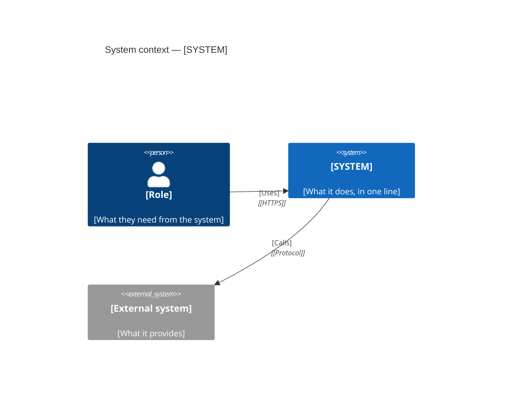
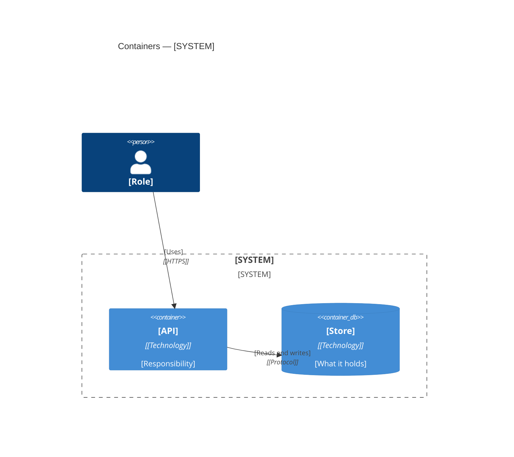
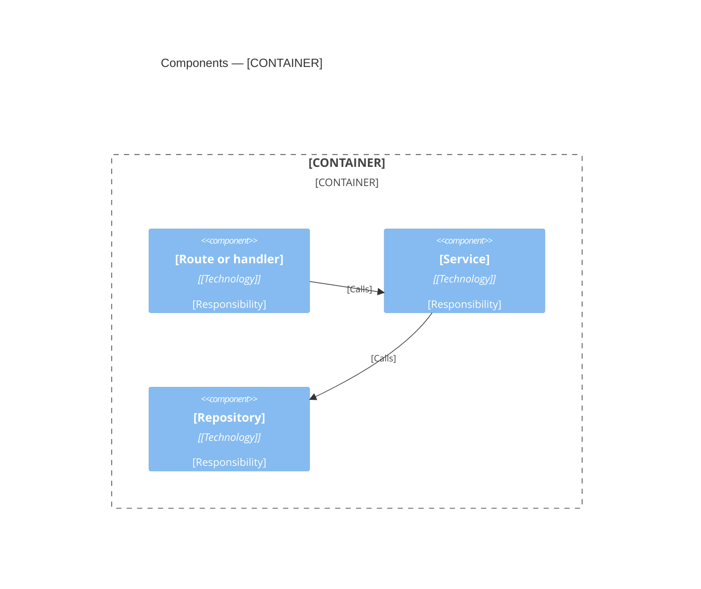

# Architecture: [FEATURE NAME]

**Spec:** [link to spec.md] · **Plan:** [link to plan.md]
**Created:** [YYYY-MM-DD] · **Status:** Draft

The C4 views of this feature, as Mermaid diagrams. Every element in a diagram exists in the plan
or in the code. Every name in a diagram is the name the code uses.

<!-- slot:preamble -->
## Level 1 — System context

Who uses the system, and which other systems it talks to.

| Element | Kind | Responsibility | Defined in |
|---|---|---|---|
| [Role] | Person | [What they do] | spec.md, [story id] |
| [External system] | External system | [What it provides] | plan.md, [section] |

## Level 2 — Containers

The deployable units and the data stores, and how they talk.

| Container | Technology | Responsibility | Source path |
|---|---|---|---|
| [API] | [Technology] | [One responsibility] | `[path]` |

## Level 3 — Components

One diagram per container that this feature changes.

| Component | Responsibility | Source path | Requirements |
|---|---|---|---|
| [Service] | [One responsibility] | `[path]` | FR-001 |

<!-- slot:sections-after-components -->
## Verification

A diagram that the code has outgrown is worse than no diagram. The tasks phase adds a task that
checks each row below against the code.

| Check | How |
|---|---|
| Every container and component names a source path that exists | List the paths; open each |
| Every relation in a diagram has a call or a dependency in the code | Search for the import or the client |
| No component in the code is missing from Level 3 | Compare with the source directory |
<!-- slot:verification-rows -->
