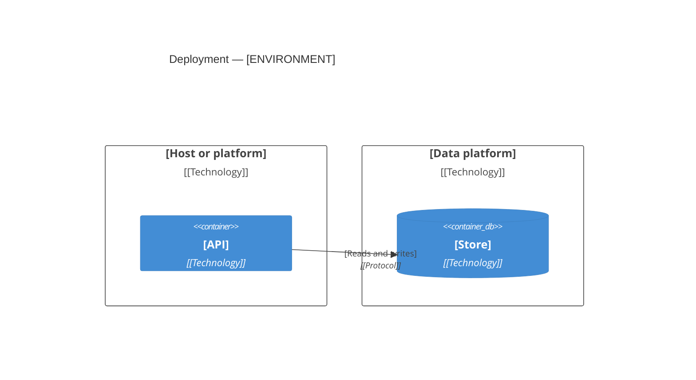

# Deployment: [FEATURE NAME]

**Spec:** [link to spec.md] · **Plan:** [link to plan.md]
**Created:** [YYYY-MM-DD] · **Status:** Draft

How the feature runs: where each part is deployed, in which order it starts, and what it reads
from its environment.

<!-- slot:preamble -->
## Deployment view

| Unit | Runs on | Instances | Health check | Source of the definition |
|---|---|---|---|---|
| [API] | [Platform] | [n] | `[path or command]` | `[Dockerfile, manifest or pipeline path]` |
<!-- slot:unit-rows -->

## Start-up order

| Order | Unit | Waits for | Ready when |
|---|---|---|---|
| 1 | [Store] | — | [Check] |
| 2 | [Migrations] | [Store] | [Check] |
| 3 | [API] | [Migrations] | [Health check passes] |

## Configuration

Names only. A value never goes in this file, and a secret never goes in the repository.

| Variable | Used by | Required | Secret | Default | Purpose |
|---|---|---|---|---|---|
| `[NAME]` | [Unit] | yes | no | `[value]` | [What it sets] |
<!-- slot:configuration-rows -->

## Roll back

| Step | Action | Who | Check |
|---|---|---|---|
| 1 | [How to return to the previous version] | [Role] | [How you know it worked] |

<!-- slot:sections-end -->
