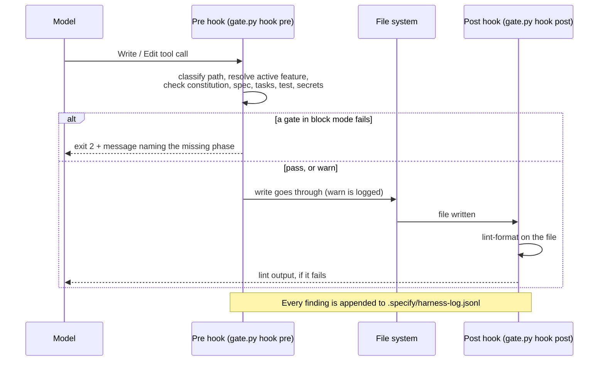
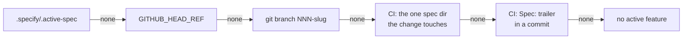

# Harness

A model writes the code. The **harness** is everything around the model that decides what it
reads, what it may do, and what happens when it does the wrong thing. This document has two
parts: the concepts, each with how this framework uses it, and the reference for the six gates.

Related: [TEMPLATES.md](TEMPLATES.md) · [ONBOARDING-GREENFIELD-BROWNFIELD.md](ONBOARDING-GREENFIELD-BROWNFIELD.md) ·
[INDUSTRY_PROFILES.md](INDUSTRY_PROFILES.md) · [ARCHITECTURE.md](ARCHITECTURE.md) · [COPILOT.md](COPILOT.md)

Command names below are the Claude Code form, `/sdd-speckit:speckit.<phase>`. In GitHub Copilot
the same phase is `/sdd-speckit-<phase>`.

## Part 1 — Concepts

### What a harness is made of

| Part | What it does | Deterministic? |
|---|---|---|
| Context and memory files | Tell the assistant the rules before it starts | No. The model reads them and can ignore them. |
| Commands and skills | Package one phase of work as a repeatable prompt | No |
| Subagents and model tiers | Give each phase a fresh context, a tool set and a model | Tool set: yes. Behaviour: no. |
| Templates | Give every artifact a fixed structure | Structure: yes. Content: no. |
| Hooks | Run a script before or after a tool call | **Yes** |
| Settings and permission rules | Allow, ask for, or deny a tool call | **Yes** |
| MCP connectors | Give the assistant tools for outside systems | Yes, for what is reachable |
| CI gates | Run the same checks on the pull request | **Yes** |
| Feedback loops | Return a result to the model so it corrects itself | Mixed |

The useful split is the last column. An instruction is a request. A hook, a permission rule and
a CI job are enforcement. A good harness states each important rule twice: once as an
instruction, so the model does the right thing first, and once as a check, so a miss is caught.

### Context and memory files

These files are loaded into the model's context. They are the cheapest control and the weakest.

| File | Read by | Written by | Holds |
|---|---|---|---|
| `AGENTS.md` | Claude Code (through `CLAUDE.md`), GitHub Copilot, most other assistants | The composer, inside a marked block. The team, outside it. | Phase order, hard rules, build and test commands, stack conventions, industry rules |
| `CLAUDE.md` | Claude Code | The composer, inside a marked block | An import of `AGENTS.md`, plus what applies to Claude Code only |
| `.github/copilot-instructions.md` | GitHub Copilot | The Copilot render | The phase table and rules for Copilot |
| `.specify/memory/constitution.md` | Every phase | Only `/sdd-speckit:speckit.constitution` | Principles, gates N1 to N5, profile gates `G-<XX>-n`, the quality bar |
| `specs/<NNN>-<slug>/*.md` | The phases after the one that wrote them | The phase commands | The feature's spec, plan, tasks and log |

Keep these files short. Every line costs context in every session. A rule that a script can check
belongs in a gate, with one line in `AGENTS.md` that names it.

### Commands and skills

A command is a prompt with a name. `commands/speckit.<phase>.md` holds one phase: what to read
first, when to refuse, what to do, where to write, and what to report. Each command names its
model tier and the subagent it delegates to. A skill (`skills/*/SKILL.md`) is loaded when its
description matches the task. In GitHub Copilot the commands are rendered as skills in
`.github/skills/sdd-speckit-*/`.

### Subagents and model tiers

A subagent runs with its own context window, its own tool list and its own model. The framework
uses that for three things:

- **Isolation.** A read-heavy phase does not fill the main conversation.
- **Least privilege.** `codebase-cartographer`, `code-reviewer` and `research-scout` have no
  write tools. A read-only agent cannot edit a file, whatever its prompt says.
- **Cost.** Each phase runs on the tier that fits it. See [MODEL_ROUTING.md](MODEL_ROUTING.md).

### Hooks

A hook is a script that the assistant runs at a fixed point: before a tool call, after it, or at
session start and end. The script gets the tool call as JSON on stdin. A pre-tool hook can refuse
the call. This is how the framework turns a rule into a check.

| Hook | When | Script |
|---|---|---|
| Gates, pre stage | Before a file write | `scripts/harness/hook.sh pre` → `gate.py hook pre` |
| Gates, post stage | After a file write | `scripts/harness/hook.sh post` → `gate.py hook post` |
| Artifact log | After a file write | `scripts/hooks/log-artifact-change.sh` |
| Model tier reminder | Session start (Claude Code) | `scripts/hooks/model-tier-reminder.sh` |
| Usage summary | Session end (Claude Code) | `scripts/hooks/session-usage-summary.sh` |

### Settings and permission rules

Claude Code reads `.claude/settings.json`. Its `permissions` block has three lists: `allow` (run
without asking), `ask` (confirm each time) and `deny` (never). The onboarding script merges a
baseline into that file; see [the generated settings](#generated-claudesettingsjson). Permission
rules act on the tool call itself, so they also cover shell commands, which the write hooks do
not see.

### MCP connectors

An MCP server gives the assistant tools for an outside system: the issue tracker, the design
file, a browser. The installer writes the chosen servers to `.mcp.json`. A connector widens what
the assistant can reach, so add only the ones a phase needs. See
[MCP_CONNECTORS.md](MCP_CONNECTORS.md).

### Guardrails are not security boundaries

**The gates guard against accidents. They are not a security boundary.**

- A hook sees the file-writing tools. It does not see a file written by a shell command.
- A hook fails open. A payload it cannot read, a missing config or an internal error lets the
  tool call through.
- The unlock marker for the constitution is a file anyone can create.
- The secrets scan is a list of patterns. It finds common credential shapes, not every secret.

So: keep real secrets out of reach with permission `deny` rules and with the operating system.
Protect the default branch with branch protection and required reviews. Treat the gates as a
seat belt, not as a lock.

### CI gates: the equaliser

Assistants differ. Claude Code has hook matchers, permission rules and post-write feedback.
GitHub Copilot hooks have no matcher and no permission file. Another assistant may have no hooks
at all. A person can also write code with no assistant.

The pull request is the one place every change goes through. `gate.py ci` runs the same six
gates there, with the same modes from the same file. A gate that an assistant missed locally
still fails the pull request.

### Feedback loops

A check is more useful when its result goes back to the model.

| Loop | How it closes |
|---|---|
| Blocked write | The pre hook exits 2. The message names the missing artifact and the phase that makes it. The model reads it and runs that phase. |
| Lint after write | The post hook runs `commands.lintFile` on the file just written. On failure, the last 20 lines of output go back to the model. |
| Warn log | Every finding, warn or block, is one JSON line in `.specify/harness-log.jsonl`. A team reads it to decide when a gate can move to `block`. |
| Analyze | `/sdd-speckit:speckit.analyze` compares the artifacts and reports each conflict. It writes nothing. |
| Converge | `/sdd-speckit:speckit.converge` compares the spec with the shipped code and appends gap tasks. |
| Implementation log | `implementation-log.md` records each task's commit, test evidence and deviation. |

### Templates as structure

A template fixes the sections and tables of an artifact. That makes artifacts comparable across
features, and it lets a later phase or a script find things by position: a `T###` row, an
`NFR-` id, a gate row. Industry and stack profiles add rows and sections through slots, so a
regulated project gets its controls in every artifact without anyone remembering to ask. See
[TEMPLATES.md](TEMPLATES.md).

## Part 2 — Gate reference

One runner, `scripts/harness/gate.py`, serves the hooks and CI. One file,
`scripts/harness/gates.json`, defines the gates, the modes, the defaults, the default globs, the
secret patterns and the baseline permissions.

What happens when the assistant writes a source file:



### The six gates

| Gate | Hook check (per write) | CI check (per pull request) |
|---|---|---|
| `constitution-guard` | Pre. A write to `.specify/memory/constitution.md` needs the marker `.specify/.constitution-unlock`. | The constitution changed, and it existed at the base: the diff must add a `**Version:**` line and a new amendment-log row (`\| x.y.z \|`). |
| `spec-before-code` | Pre. A source write needs an active feature whose directory has `spec.md` and `plan.md`. | Source changed: a feature must resolve, and it must have `spec.md` and `plan.md`. |
| `tasks-before-implement` | Pre. A source write needs `tasks.md` in the active feature with at least one `\| T### \|` row. | The same, against the resolved feature. |
| `test-first` | Pre. A source write needs a test file among the uncommitted changes, or in the commits since the merge base with the default branch. Not in a git repository: the gate passes. | Source changed: a test file must change too, and the first commit that touches a test must not come after the first commit that touches source. |
| `secrets-scan` | Pre. The target path is not a credential file by name, and the text being written matches no secret pattern. | No changed file is a credential file by name, and no added line matches a pattern. When `gitleaks` is on `PATH`, it also scans the pull request's commits. |
| `lint-format` | Post. Runs `commands.lintFile` on each written source or test file, with a 20 second limit. A missing or slow linter never blocks. | Runs `commands.lint` and `commands.format`. A non-zero exit is a finding. |

Notes:

- A file is **source**, **test**, **exempt** or **other**. The runner checks `testGlobs` first,
  then `exemptGlobs`, then `sourceGlobs`. Only a source file triggers the three process gates.
- Credential files by name: `.env`, `.env.*`, `*.pem`, `*.p12`, `*.pfx`, `id_rsa`, `id_ed25519`,
  `credentials.json`, `secrets/**`. Allowed: `.env.example`, `.env.sample`, `.env.template`.
- Secret patterns: the ten in `gates.json` (private key, AWS key id, GitHub token, Slack token,
  Stripe live key, Google API key, Anthropic API key, JWT, connection string with a password, an
  assigned secret), plus the `sensitivePatterns` of the project's industry profile.
- The scan reports the pattern id only. The matched text is never printed or logged.
- The CI scan uses the same patterns. It does not call an external scanner.

### Modes

| Mode | Hook | CI |
|---|---|---|
| `off` | The gate does not run. | The row shows `off`. |
| `warn` | The write goes through, exit 0. The finding is logged. Claude Code gets it as `{"systemMessage": …}` on stdout. Other assistants get it on stderr. | An `::warning` annotation. The job passes. |
| `block` | Exit 2. The message goes to stderr, which Claude Code returns to the model. In the pre stage the runner also prints `{"permissionDecision": "deny", "permissionDecisionReason": …}` on stdout, which GitHub Copilot reads. | An `::error` annotation. The job exits 1. |

Every finding, in either mode, is appended to `.specify/harness-log.jsonl` with the gate, the
mode, the stage, the paths, the first line of the message and a UTC time. The file is local state
and is in `.gitignore`.

### Defaults per project mode

| Gate | greenfield | brownfield | migrated |
|---|---|---|---|
| `constitution-guard` | block | block | block |
| `spec-before-code` | block | warn | off |
| `tasks-before-implement` | block | warn | off |
| `test-first` | block | warn | off |
| `secrets-scan` | block | block | off |
| `lint-format` | block | warn | off |

**migrated** is what a project gets when its record was written before 0.3.0 and has no
`harness.gates`. It keeps the 0.2 behaviour: only the constitution guard runs. Nothing starts to
block on upgrade. The project opts in by giving a mode: `--mode=…`, or `--gates=default`.

### How the active feature is resolved

In this order. The first that names an existing `specs/<NNN>-<slug>/` directory wins.



1. `.specify/.active-spec`. The specify, plan, tasks and implement phases write it.
2. The `GITHUB_HEAD_REF` environment variable, when it is `NNN-slug` (CI).
3. The current git branch, when it is named `NNN-slug`.
4. CI only: the one spec directory the change touches, when it touches exactly one.
5. CI only: a `Spec: NNN-slug` trailer in a commit message of the pull request.

Two rules follow from the code:

- **There is no "newest spec" fallback.** It would pass every edit after the first spec.
- **`specs/_baseline/` never counts.** A baseline spec describes code that already exists. The
  name must match `NNN-slug`: three digits, a hyphen, lowercase letters, digits and hyphens.

To name the feature by hand: `echo 001-orders > .specify/.active-spec`.

### The `harness` block

In `.specify/sdd-speckit.json`:

```json
{
  "mode": "brownfield",
  "industry": "healthcare",
  "stack": "python-fastapi",
  "harness": {
    "gates": {
      "constitution-guard": "block",
      "spec-before-code": "warn",
      "tasks-before-implement": "warn",
      "test-first": "warn",
      "secrets-scan": "block",
      "lint-format": "warn"
    },
    "sourceGlobs": ["app/**", "src/**"],
    "testGlobs": ["tests/**", "**/test_*.py", "**/*_test.py"],
    "exemptGlobs": ["**/*.md", "docs/**", ".github/**", ".specify/**", "specs/**", ".claude/**", ".vscode/**", ".idea/**"],
    "commands": { "test": "uv run pytest", "lint": "uv run ruff check .", "format": "uv run ruff format --check .", "lintFile": "uv run ruff check {file}" },
    "secretsAllow": []
  }
}
```

| Key | Meaning | Filled from |
|---|---|---|
| `gates` | The mode of each gate | A flag, then the record, then the default for the mode |
| `sourceGlobs`, `testGlobs` | What counts as source and as test | Greenfield: the stack profile, then the scan. Brownfield: the scan, then the stack profile. Last: `gates.json`. |
| `exemptGlobs` | Paths no process gate applies to | `gates.json` |
| `commands` | `test`, `lint`, `format`, `lintFile`. `{file}` is replaced by the quoted path. | The stack profile and the scan |
| `secretsAllow` | Pattern ids to skip, and path globs to skip | Empty. The team adds to it. |
| `gitleaks` | Whether the CI secrets scan also runs `gitleaks`: `auto`, `off` or `required` | `auto` |

A value the team has set is kept on every later run. In `secretsAllow`, an entry that contains
`/`, `*` or `.` is a path glob; any other entry is a pattern id, for example `us-ssn`.

**gitleaks in CI.** The pattern scan always runs. With `gitleaks: auto`, `gate.py ci` also runs
`gitleaks` over the commits between the base and the head when the binary is on `PATH`, and
skips it quietly when it is not. `required` turns a missing or failing `gitleaks` into a finding.
`off` never runs it. Findings are reported by file and rule id; values are redacted. A rule id
or a path glob in `secretsAllow` drops a `gitleaks` finding too. The generated workflow does not
install `gitleaks`: add your organisation's approved install step to `sdd-gates.yml`. The hooks
do not run it; a per-write scan stays on the patterns. `gate.py status` shows the setting and
whether the binary is installed.

For one deliberate test value, put the pragma `sdd-allow-secret` on the same line:

```python
FAKE_KEY = "AKIA................"  # sdd-allow-secret
```

Glob syntax: `**/` matches zero or more directories, `**` matches anything, `*` matches within
one path segment, `?` matches one character.

### How to change a gate

| Way | Command |
|---|---|
| In a session | `/sdd-speckit:speckit.setup gates` |
| Node installer | `npx create-sdd-speckit-app . --yes --gate=test-first=block` |
| Bash installer | `./installer/install.sh . --yes --gate=test-first=block` |
| Script | `python3 .specify/sdd-speckit/scripts/onboard-project.py --project . --gate test-first=block` |
| All gates at once | `--gates=default`, `--gates=off`, `--gates=warn` or `--gates=block` |

Each path keeps the other answers. In a brownfield project, record each move in the ratchet log
of `.specify/adoption-roadmap.md`. The assistant is told not to change a gate mode by itself, and
`Edit(.specify/sdd-speckit.json)` is an `ask` permission in Claude Code.

### Generated `.claude/settings.json`

For a Claude Code target, `scripts/onboard-project.py` merges these. It adds; it never removes a
rule or a hook that is already there.

| List | Rules |
|---|---|
| `allow` | `Bash(git status:*)`, `Bash(git diff:*)`, `Bash(git log:*)`, `Bash(git branch:*)`, `Bash(python3 .specify/sdd-speckit/scripts/*)`, plus `permissions.allow` of the stack profile |
| `ask` | `Bash(git push:*)`, `Edit(.github/workflows/**)`, `Edit(.specify/sdd-speckit.json)` |
| `deny` | `Read(./.env)`, `Read(./.env.local)`, `Read(./**/*.pem)`, `Read(./secrets/**)`, `Bash(git push --force:*)`, `Bash(git push -f:*)`, `Bash(rm -rf /:*)` |

The constitution is not in `deny`. A deny rule would also stop the constitution phase.

Hooks:

| Event | Matcher | Command |
|---|---|---|
| `PreToolUse` | `Write\|Edit\|MultiEdit\|NotebookEdit` | `python3 "$CLAUDE_PROJECT_DIR/.specify/sdd-speckit/scripts/harness/gate.py" hook pre` |
| `PostToolUse` | `Write\|Edit\|MultiEdit` | `python3 "$CLAUDE_PROJECT_DIR/.specify/sdd-speckit/scripts/harness/gate.py" hook post` |

The project calls the runner pinned in `.specify/sdd-speckit/`, so the hooks and CI run the same
version, with or without the plugin.

### Generated `.github/workflows/sdd-gates.yml`

Runs on every pull request, with `contents: read`:

1. Checkout with `fetch-depth: 0`. The gates read the commits of the pull request.
2. Set up Python 3.12, then the stack profile's toolchain steps (slot `stack-setup`).
3. `python3 .specify/sdd-speckit/scripts/compose-templates.py --project . --check`
4. `python3 .specify/sdd-speckit/scripts/harness/gate.py ci --base "origin/${{ github.base_ref }}"`

The job prints one row per gate and writes the same table to the job summary. Commit
`.specify/sdd-speckit/` and `.specify/sdd-speckit.json`, or the job has nothing to run.

### GitHub Copilot limits

| Topic | Claude Code | GitHub Copilot |
|---|---|---|
| Hook file | Plugin `hooks/hooks.json`, and `.claude/settings.json` | `.github/hooks/sdd-speckit.json` |
| Matcher | Write tools only | None. The hook runs on every tool call; the runner filters on the tool name and the path. |
| Block | Exit 2, stderr to the model | Exit 2 and the deny JSON on stdout |
| Warn | `systemMessage` shown in the session | stderr only. It may not reach the model. |
| Post-write lint feedback | Returned to the model | Not relied on |
| Permission rules | `.claude/settings.json` | No equivalent file |

For Copilot, treat CI as the gate that counts. See [COPILOT.md](COPILOT.md).

### Run the runner by hand

```bash
python3 .specify/sdd-speckit/scripts/harness/gate.py status          # modes, active feature, globs
python3 .specify/sdd-speckit/scripts/harness/gate.py status --json
python3 .specify/sdd-speckit/scripts/harness/gate.py ci --base origin/main
python3 .specify/sdd-speckit/scripts/harness/gate.py ci --base origin/main --head my-branch
```

`ci` exits 1 when a gate in `block` mode has a finding, and when the base ref does not resolve.

### Troubleshooting

| Symptom | Cause | Fix |
|---|---|---|
| No gate ever fires on a source write | The source files match no `sourceGlobs`, or they match `exemptGlobs` or `testGlobs` first | Run `gate.py status`. Correct the globs in `.specify/sdd-speckit.json`. |
| `status` says only the constitution guard runs | The record has no `harness.gates` (a project from before 0.3.0) | Choose a mode: `--mode=brownfield` or `--gates=default` |
| "no feature is active" on every write | No `.specify/.active-spec`, and the branch is not named `NNN-slug` | Run the specify phase, or write the file by hand |
| `test-first` blocks although a test exists | The test path matches no `testGlobs` | Correct `testGlobs` |
| The secrets scan stops a fixture | A test value has a real secret's shape | The `sdd-allow-secret` pragma on that line, or the pattern id or a path glob in `secretsAllow` |
| A write is checked twice | Should not happen. `hook.sh` in the plugin stands down when `.claude/settings.json` wires the pinned runner. | Check that `.specify/sdd-speckit/scripts/harness/gate.py` exists |
| A hook error appears and the write goes through | Fail-open by design: bad payload, no `python3`, or a runner error | Read the stderr line. The CI job still checks the change. |
| CI: "base ref does not resolve" | Shallow checkout | `fetch-depth: 0` |
| CI: "Composed templates are stale" | A profile, a fragment or the pinned framework changed | `python3 .specify/sdd-speckit/scripts/compose-templates.py --project .`, then commit |

### What is verified, and what is not

Verified by the test suite in `installer/create-sdd-speckit-app/test/gate.test.js`, which pipes
payloads into the runner in temporary git repositories: block and warn in the pre stage, each
missing artifact, the baseline exclusion, the secrets scan and the pragma, an industry pattern,
the constitution guard, the fail-open path, and `ci` in block and warn modes.

**Not yet verified in a live assistant session:**

- The hooks firing inside a real Claude Code session and a real GitHub Copilot session.
- That one write causes exactly one runner call when both the plugin and the project wire it.
- How each assistant shows the `warn` message.
- The post-write lint output reaching the model.
- `sdd-gates.yml` on a real GitHub pull request.

Test these in your own project before you rely on a gate at `block`.
